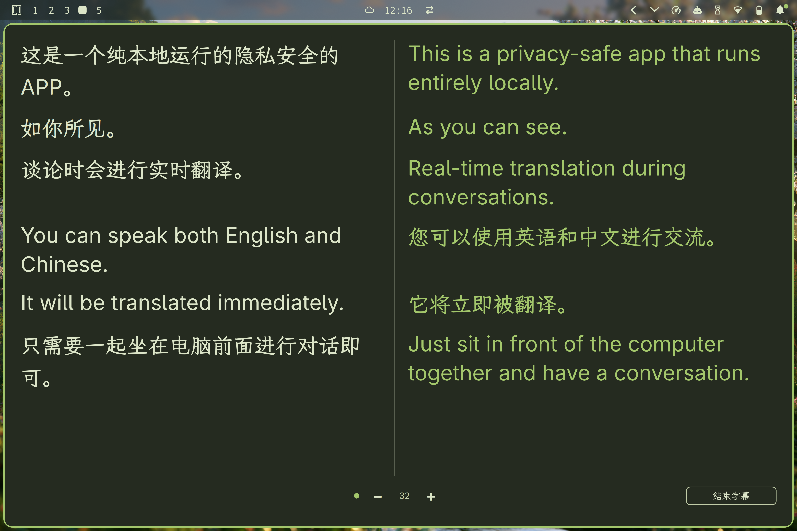
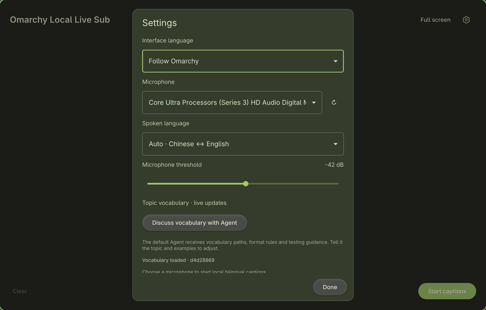

# Omarchy Local Live Sub

**English** | [简体中文](README.zh-CN.md)

**One conversation. Two languages. All local.**

Live Chinese–English captions and translation for face-to-face conversations on Omarchy. Pick a room microphone and put the original speech and its translation side by side, so everyone can follow along on the same screen.

Built for technical discussions, product demos, and conversations with visiting teams.

## In action

Original speech and live translation, side by side. Click any screenshot to view it at full resolution.

[](assets/screenshots/live-captions.webp)

English settings: choose your microphone, spoken language, and topic vocabulary.

[](assets/screenshots/settings-en.webp)

[Get started](#get-started) · [Using the app](#using-the-app) · [Tune your vocabulary](#make-it-understand-your-topic) · [Installation & troubleshooting](INSTALL.md)

## Why use it?

- **Your conversation stays on your machine.** Speech recognition and translation run locally. After setup, captions work offline without a cloud account or API key.
- **Made to be read across a room.** Aligned original and translated text, streaming translations, fullscreen reading, and font sizes you can adjust while people speak.
- **Chinese ↔ English, automatically.** Detect the spoken language and translate in the other direction, or choose a fixed input language. The English and Chinese UI can be switched independently.
- **Vocabulary that follows the discussion.** Tune recognition hotwords, recurring misrecognitions, and translation terms. Valid vocabulary edits take effect during use without retraining or reloading the models.
- **At home on Omarchy.** A C++ / Qt Quick interface that follows your light or dark theme and colors live. Independent microphone capture leaves your existing Voxtype, Fcitx/Rime, and audio settings in place.
- **Keep a record you can check.** Export the raw recognition, corrected original, translation, and correction history. Audio stays in memory.

## Get started

### What you need

| Requirement | Details |
| --- | --- |
| Desktop | x86_64 Omarchy / Arch Linux, in your logged-in desktop session |
| Verified hardware | Intel Core Ultra 9 285H, and Intel Core i7-1260P (Iris Xe, 16 GB RAM, Huawei MateBook), both with Intel integrated graphics using Vulkan |
| Memory & disk | 16 GB RAM is enough (verified); about 10 GB free disk space for setup |
| Microphone | A microphone positioned for the people speaking |
| First setup | Internet access to GitHub, Hugging Face, and PyPI; about 2.85 GB of models, plus dependencies and source code |

Other x86_64 hardware configurations may also work, but have not been verified. Check the appropriate GPU drivers and test performance on your machine.

The default configuration uses CPU speech recognition and Vulkan-accelerated translation. No NPU or Voxtype installation is required. This is currently a source installation; setup builds the app and inference engine on your machine.

### Install and launch

Clone into a directory you will keep:

```bash
git clone https://github.com/NeroSong/omarchy-local-live-sub.git
cd omarchy-local-live-sub
./bin/doctor --preflight --json
```

Resolve any missing prerequisites using the [installation guide](INSTALL.md#1-prerequisites), then run as your normal desktop user:

```bash
./bin/setup --desktop
./bin/start --settings
```

Setup downloads missing models, verifies their pinned SHA256 checksums, creates isolated Python environments, builds locally, runs tests, and adds a launcher entry for your user. Interrupted downloads can be retried; valid cached models are reused. Keep the checkout in place because the launcher points to it.

You can also search your launcher for **Omarchy Local Live Sub**. See the [full guide](INSTALL.md) for package commands, diagnostics, CPU fallback, and recovery.

### Prefer an AI to help with installation?

Give a terminal-capable agent the repository link and this prompt:

> Install and launch https://github.com/NeroSong/omarchy-local-live-sub on this Omarchy machine. Read README.md, INSTALL.md, and AGENTS.md first. Check prerequisites, install only missing dependencies, use the default Vulkan mode if supported, and add the current user's launcher entry. Let the scripts download and verify missing models. Preserve existing input, audio, desktop settings, vocabulary, and sessions. Open settings so I can select a microphone and test real English and Chinese speech. Report failures and untested steps; demo mode and healthy services do not prove microphone acceptance.

## Using the app

1. **Choose your microphone.** Open settings and select the physical microphone, rather than a monitor/system playback source. Start with speech language set to Auto.
2. **Start captions and talk.** The original appears on the left; after a pause, the translation streams on the right. Speak a sentence in each language to check both directions.
3. **Make it easy to read.** Use fullscreen and the bottom − / + controls to adjust both columns from 18 to 72 px while captions are running.
4. **Stop, then export what you need.** Stopping releases the microphone and lets queued work finish. Export before closing if you want to keep the conversation; unexported captions are not saved automatically.

Original text is refreshed roughly every two seconds using the accumulated speech. A pause of about 0.9 seconds submits the utterance for translation; continuous speech is capped at 18 seconds. These are segmentation settings, not a guaranteed end-to-end latency.

| Shortcut | Action |
| --- | --- |
| Space | Start / stop captions |
| F11 / Esc | Enter / leave fullscreen |
| Ctrl+, | Settings |
| Ctrl+S | Export a caption snapshot |
| PageUp / PageDown | Read the previous / next page |
| Home / End | Earliest content / follow latest |
| ? | Help |
| Q | Quit; confirms while capturing, otherwise drains pending work and closes |

New caption updates follow the latest text automatically. Exports go to `${XDG_DATA_HOME:-~/.local/share}/live-sub/sessions/` and include recognition and vocabulary metadata. Reopen an exported session with:

```bash
./bin/run --restore-session ~/.local/share/live-sub/sessions/session-example.json
```

**Try it in the room before the meeting.** Overlapping speakers, echo, distance, noise, and mixed-language sentences affect results. The app uses an energy threshold to detect pauses, and the 18-second cap can split long sentences. Translation is displayed as text; there is no translated audio playback.

## Make it understand your topic

Names, projects, and technical terms deserve their own vocabulary. Edit the active files in `~/.config/live-sub/` (or the configuration directory shown in settings), not the bundled defaults in the checkout. There are three places to tune:

| When… | Edit… | Example |
| --- | --- | --- |
| Recognition misses a name | `hotwords` in `asr-config.json` | `{"term":"ExampleCorp","score":3}` |
| The same wrong spelling keeps appearing | A term's `aliases` in `glossary.json` | Map `example corp` to `ExampleCorp` |
| The name is right but its translation is wrong | A term's `translations` in `glossary.json` | Use `示例公司` in Chinese and `ExampleCorp` in English |

For example, add this entry to the existing glossary array:

```json
{
  "term": "ExampleCorp",
  "aliases": ["示例公司", "example corp"],
  "translations": {"zh": "示例公司", "en": "ExampleCorp"}
}
```

Hotwords accept unique, case-insensitive English-letter terms of 3–32 characters, scores in `(0, 8]`, and up to 128 entries. Names with digits or Chinese characters belong in the glossary instead. Translation mappings guide the model; check the result with a real example.

Save valid JSON and subsequent work picks it up automatically. Invalid edits retain the running process's last valid configuration and show an error. Completed captions are not rewritten. Changing the decoder, thread count, or entire configuration directory requires a service restart.

In settings, **Open Agent to discuss vocabulary** opens your configured Omarchy agent with the vocabulary paths and editing guidance. Discuss your topic and examples first. The app does not automatically include captions, recordings, or logs in that prompt; the agent's provider may use online services. Captions work without an agent.

**About the bundled Omarchy rule:** defaults are conservative. Confirmed aliases such as `o match` and `omachi` are corrected; ambiguous forms such as `O much` need related context. Common phrases such as “how much,” “so much,” and “too much” stay unchanged. The Omarchy recognition hotword uses a score of 6 to favor acoustically plausible candidates; this does not guarantee recognition. Aggressive phonetic correction remains available by explicitly setting `force_phonetic` to `true` for a specialized topic, but can rewrite ordinary speech. Retain the `come`, `how much`, `so much`, and `too much` protections in `preserve` and review `raw` and correction records when tuning.

For separate topic folders, the complete glossary schema, and decoder details, see the [extended Chinese reference](README.zh-CN.md#现场调整与主题配置). To use a topic folder, put both JSON files there and set `LIVE_SUB_CONFIG_DIR` when starting. Stop capture, drain pending work, export, and stop model services before switching directories.

## Local processing and service lifecycle

Audio and caption text are processed on your machine. The default recognition and translation services listen only on `127.0.0.1:8178` and `127.0.0.1:8179` and require a per-run private token (`~/.local/state/live-sub/api-token`, readable only by you), so other local users and web pages cannot use them. Capture uses an independent ffmpeg process and does not change default audio devices, gain, global shortcuts, or other speech-input tools.

Audio is kept in memory. Caption files are written when you export; `~/.local/state/live-sub/logs/` may also contain recognized text, and service startup replaces the ASR/translation logs while launcher/UI logs append. Treat logs and exports as conversation data.

Models are released automatically after 15 minutes without captions (about 1.5 GB of RAM for recognition, plus the translation model). While captions are running, the app keeps them alive during quiet stretches; when you start captions again after a release, the app reloads the models, which takes a short moment. Set `LIVE_SUB_IDLE_MINUTES` (0 keeps them loaded until stopped) to change this. To check or release them immediately:

```bash
./bin/start --status
# Stop capture, wait for pending work, and export anything needed first.
./bin/models-stop
```

The stop command checks the project's supervisor identity and stops only matching project services. Occupied ports produce an error rather than terminating unrelated processes.

## Under the hood

| Component | Default |
| --- | --- |
| Speech recognition | SenseVoice Small FP32, ONNX Runtime, 6 CPU threads |
| Recognition decoder | Experimental hotword-boosted CTC search; explicit sherpa-onnx greedy fallback available |
| Translation | Hy-MT2-1.8B Q8_0 through llama.cpp, Vulkan by default |
| Interface | C++ / Qt Quick, English and Simplified Chinese, live Omarchy theme updates |
| Reproducibility | Pinned upstream commits and model checksums in `dependencies.lock.json` |

Hotword decoding uses the existing ONNX model without training or modifying it. It can improve candidate priority, but can also add decoding time or misrecognitions. Failures are reported explicitly; services do not silently switch recognizers or fall back to CPU. See [troubleshooting](INSTALL.md#5-troubleshooting) for explicit fallback steps.

## Development

After installing the [prerequisites](INSTALL.md#1-prerequisites):

```bash
./bin/build
./bin/run --demo
```

Demo mode displays sample text without recording or loading models. For a full development setup, use `./bin/setup` without `--desktop`.
Build, setup, test and source launch share a checkout-specific directory under
`~/.local/share/live-sub/runtime/ui-build/` (or the configured XDG data directory).
Use the same `LIVE_SUB_BUILD_DIR` for build and run to override it. After upgrading
from the old `build/` layout, rebuild once; old binaries are retained but not selected.

```bash
./bin/test
python3 tests/setup_tests.py
# When the hotword environment is available:
~/.local/share/live-sub/runtime/hotword-venv/bin/python tests/hotword_decoder_tests.py
```

Qt tests cover segmentation, PCM/WAV, terminology, translation direction, output cleanup, and SSE parsing. Installation regressions use tiny fake downloads. For real local inference checks after setup, use `./bin/doctor --services --json` and `./bin/smoke-test --json`; neither replaces speaking into a microphone.

Run `./bin/test-all` for the complete model-free Qt/QML, ASR HTTP, lifecycle, migration and installation regressions. See [system integration](SYSTEM-INTEGRATION.md) for independent packaging, private XDG paths, non-destructive migration and release acceptance.

`src/` contains the app, `bin/` the setup and lifecycle tools, and `tests/` the regressions. Models, environments, logs, builds, sessions, and topic folders stay local and are excluded from Git. Optional Arch packaging via `./bin/install` is separate from the recommended source setup; see the [packaging reference (Chinese)](README.zh-CN.md#开发与可选安装).

Issues and contributions are welcome. For a bug report, include your hardware, relevant command, and error message. Remove conversation text and credentials from any logs you share.

## License and acknowledgments

Application code is [MIT licensed](LICENSE). Models and third-party engines have their own upstream licenses and are downloaded separately.

- [SenseVoice / sherpa-onnx](https://k2-fsa.github.io/sherpa/onnx/sense-voice/index.html)
- [Hy-MT2-1.8B](https://huggingface.co/tencent/Hy-MT2-1.8B) / [GGUF models](https://huggingface.co/tencent/Hy-MT2-1.8B-GGUF)
- [llama.cpp](https://github.com/ggml-org/llama.cpp)
