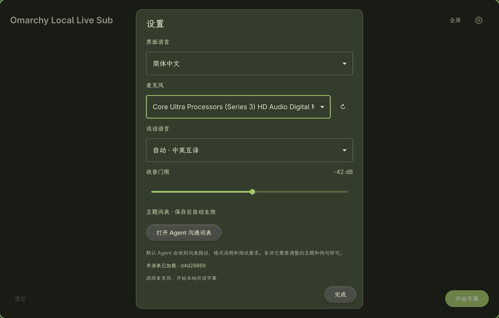

# Omarchy Local Live Sub

[English](README.md) | **简体中文**

**面对面交流，中英双语字幕，全程本地运行。**

为 Omarchy 打造的实时字幕与翻译应用。选择房间里的麦克风，把中英文对话变成并排显示的原文与译文，让双方在同一块屏幕上跟上讨论。适合技术交流、产品演示和来访沟通。

## 效果演示

原文与实时译文并排显示。点击任意截图可查看原始分辨率大图。

[](assets/screenshots/live-captions.webp)

中文设置：选择麦克风、说话语言并调整主题词表。

[](assets/screenshots/settings-zh-CN.webp)

## 为什么使用它

- **准备好后即可离线使用。** 语音识别与翻译都在本机运行，字幕功能无需云端账号或 API Key，会议音频和文字不上传。
- **让整间屋子看清对话。** 原文与译文双栏对齐、译文流式显示，支持全屏和实时字号调整。
- **中英文自然切换。** 自动识别说话语言并选择翻译方向，也可固定英语或中文；界面语言可独立切换。
- **让专业名词跟上话题。** 识别热词、错词修正、翻译用词三层词表，可在讨论期间热更新，无需重新训练模型。也可请 Omarchy 默认 Agent 协助调整。
- **融入 Omarchy 桌面。** C++ / Qt Quick 界面实时跟随系统深浅主题和配色；独立采集麦克风，保留现有 Voxtype、Fcitx/Rime 和音频设置。
- **保留可核对的文字。** 主动导出原始识别、修正后的原文、译文及纠错记录；音频只保留在内存。

**支持范围：** x86_64 Omarchy / Arch Linux；已验证的硬件为 Intel Core Ultra 9 285H，以及 Intel Core i7-1260P（Iris Xe，16 GB 内存），均使用 Intel 集成显卡（Vulkan）。其他 x86_64 硬件配置也可能支持，但尚未验证，需按实际显卡确认驱动并测试运行效果。首次安装 16 GB 内存即可，另需约 10 GB 空闲磁盘及可用网络；模型下载约 2.85 GB，另需依赖和源码。

[快速安装](#给首次使用者和安装-ai) · [日常使用](#使用) · [词表与主题配置](#现场调整与主题配置) · [安装与排错](INSTALL.zh-CN.md)

## 给首次使用者和安装 AI

**把本仓库链接交给目标机器上的 AI，并让它先读 [安装与现场使用指南](INSTALL.zh-CN.md) 和 [Agent 操作约定](AGENTS.md)。** 指南包含可直接转发的安装请求、Intel 显卡的依赖命令、自动模型下载、用户启动入口和现场中英文试音步骤。

```bash
./bin/doctor --preflight --json
./bin/setup --desktop
./bin/start --settings
```

首次安装需要联网下载模型和依赖；没有安装 Voxtype 也能独立准备。此路径不创建安装包。只做开发时省略 `--desktop`。完整操作及故障排查见 [INSTALL.md](INSTALL.zh-CN.md)。

## 当前方案

- **语音识别：SenseVoice Small FP32**，当前试用 ONNX Runtime + 热词 CTC 候选搜索，CPU 6 线程；原 sherpa-onnx 模式保留可回退。
- **翻译：Hy-MT2-1.8B Q8_0**，llama.cpp 常驻服务，默认 Vulkan 加速。
- **界面：C++ / Qt Quick**，实时跟随 Omarchy 的深浅模式、背景、文字和强调色，包含字幕与弹框。
- 默认自动识别中英文，使用识别结果的语言标签选择翻译方向；标签缺失时参考原文文字。也可固定英语或中文。
- 原文约每 2 秒用累计音频更新同一段；停顿约 0.9 秒后提交整段翻译，避免每个短片段独立翻译。连续发言最长 18 秒。
- 译文流式显示，两栏对齐并自动滚动。开始后显示双栏文字、状态圆点、字号调整和结束按钮。

当前版本已由用户在本机试用，识别速度和整段翻译效果得到改善。它仍使用能量门限判断停顿，长句、重叠发言、嘈杂全场和语言混说需要按实际环境调整；18 秒上限仍可能切开特别长的句子。

## 依赖与构建

面向 Omarchy / Arch Linux。需要 Qt 6、C++ 工具链、Python 3.12–3.14（含 venv / pip）、CMake、Git、ffmpeg 和 pactl。Vulkan 构建还需 Vulkan loader、驱动及 `glslc`。

```bash
./bin/build
./bin/run --demo
```

`--demo` 只展示示例文字，不采集音频，不运行模型。构建、安装准备、测试和源码启动共用 XDG 数据目录下 `live-sub/runtime/ui-build/` 中按源码路径隔离的构建目录。可在构建与运行时设置相同的 `LIVE_SUB_BUILD_DIR` 覆盖。旧版 `build/` 中的产物保留但不再自动选取，升级后须重新构建一次。

## 准备模型与服务

### 1. SenseVoice 模型

`./bin/bootstrap` 会在模型缺失时自动下载锁定版本到 `~/.cache/live-sub/models/sensevoice-small-fp32/`，校验 SHA256 后使用，不要求安装 Voxtype。如果项目内没有完整模型而本机已有 Voxtype 的 `small-fp32`，只读校验并复用：

```text
~/.local/share/voxtype/models/sensevoice-small-fp32/model.onnx
~/.local/share/voxtype/models/sensevoice-small-fp32/tokens.txt
```

可用 `./bin/bootstrap --models-only --download-asr` 强制准备项目独立模型，不改动 Voxtype。也可自行准备 [sherpa-onnx 官方 SenseVoice FP32 模型](https://k2-fsa.github.io/sherpa/onnx/sense-voice/pretrained.html)，把 `model.onnx` 和 `tokens.txt` 放到用户缓存 `~/.cache/live-sub/models/sensevoice-small-fp32/`。旧项目目录和 Voxtype 的完整模型也可校验后只读复用。

其他位置可显式指定；准备与运行时都要设置该变量：

```bash
export SENSEVOICE_MODEL_DIR=/absolute/path/to/sensevoice-small-fp32
```

本项目不修改 Voxtype 配置，不控制其 daemon，也不使用其热键、剪贴板或键盘输出。

### 2. 安装项目内推理依赖并准备翻译模型

```bash
./bin/bootstrap
```

该脚本会检查或下载 SenseVoice 模型，在独立的 `~/.local/share/live-sub/runtime/sensevoice-venv/` 和 `~/.local/share/live-sub/runtime/hotword-venv/` 安装固定版本的 Python 依赖，下载并校验翻译模型，编译 llama.cpp 和应用。它不安装系统包，不再下载或编译 Whisper。

- `requirements.txt` / `requirements-hotwords.txt` 分别固定原识别模式和热词识别模式的依赖版本。
- `dependencies.lock.json` 记录首次准备使用的 llama.cpp / SDK 提交，以及两种模型的版本与散列。
- 新源码检出使用锁定提交；已有用户 `~/.local/share/live-sub/runtime/` 源码目录必须匹配锁定提交，不自动覆盖或更新。
- 模型下载使用锁定 SHA256 校验，通过后才替换最终文件；中断可续传，有效缓存不重新下载。
- 实际准备记录写入用户 `~/.local/share/live-sub/runtime/manifest.json`。

可选参数：

```bash
./bin/bootstrap --cpu          # 翻译使用 CPU，免 Vulkan 构建依赖
./bin/bootstrap --tools-only   # 跳过模型准备，安装推理依赖并编译
./bin/bootstrap --models-only  # 只检查 / 下载模型
```

准备可能下载数 GB 数据，需提前完成。运行期间只访问本机回环地址。

### 3. 启动

```bash
./bin/start
```

也可分开启动，便于查看服务日志：

```bash
# 终端一：等待 Both models ready
./bin/models-start

# 终端二
./bin/run
```

识别与翻译服务分别监听 `127.0.0.1:8178` 和 `127.0.0.1:8179`，并要求每次运行生成的私有令牌（`~/.local/state/live-sub/api-token`，仅当前用户可读），其他本机用户和网页无法调用。端口占用时启动失败，不停止占用端口的其他服务。模型服务在无字幕 15 分钟后自动释放（识别约占 1.5 GB 内存，另加翻译模型）；录音期间应用会保持其存活，释放后再次开始字幕会按需重新加载，需稍等片刻。可用 `LIVE_SUB_IDLE_MINUTES` 调整（0 表示不自动释放）。需要立即检查或释放时：

```bash
./bin/start --status
./bin/models-stop
```

停止脚本只操作身份匹配的项目服务进程。CPU 备用模式可使用 `./bin/models-start --cpu`。

## 热词解码实验模式

当前 `asr-config.json` 默认 `hotword_ctc`：只读使用同一份 SenseVoice FP32 ONNX 模型，读取模型内的 LFR / CMVN / 语言信息，使用 kaldi-native-fbank 提取特征，通过 ONNX Runtime 获取 CTC 概率，再进行热词增强的候选搜索。没有换用 PyTorch 模型，没有训练或修改已有模型文件。

首批十词：Omarchy、Hyprland、Quickshell、Omacom、Quattro、Linux、Arch、mise、Neovim、Rust。分值按高 / 中 / 低设为 6 / 3 / 1，Omarchy 默认加分为 6；这些分值仍需按实际收音效果调优；这些值是解码加分，不是出现概率。`hotwords` 和搜索参数支持热更新；模型、解码模式和线程数变更仍需重启服务。

搜索默认保留 4 个候选，每帧考虑 8 个高概率 token 和可延续热词的 token。按完整单词边界加分，失败的半截热词在结束时没有奖励；超过声学差距限制的候选会被剪枝，避免纯靠热词硬造文字。它能提高候选优先级，不能保证所有近音都输出指定名称，也可能增加耗时或误识别，效果由用户试用确认。

为了比较和排查，导出字幕额外保留 `asr_decoder`、同一次模型推理的普通贪心结果 `asr_greedy`、`asr_inference_ms` 和 `asr_decode_ms`。无需额外一次推理，音频仍不落盘。`raw` 是热词解码结果，`original` 是经过术语规则兜底的显示文字。

切回之前的 sherpa-onnx 识别路径：先结束窗口收音，等待字幕处理结束并导出，再执行：

```bash
./bin/models-stop
# 等待原终端中的模型服务退出，再启动
./bin/models-start --decoder greedy
```

切回热词模式使用 `./bin/models-start --decoder hotword_ctc`。也可设置 `SENSEVOICE_DECODER=greedy` 后运行 `./bin/start`，但已有服务不会被该命令替换；必须先停止已有项目服务。

两种模式的识别服务健康信息均返回实际 `decoder`；热词模式还返回当前词表。服务无法启动或推理失败时明确报错，不静默切回普通识别。

技术接口依据：[SenseVoice 模型元数据](https://github.com/k2-fsa/sherpa-onnx/blob/master/sherpa-onnx/csrc/offline-sense-voice-model.cc)、[识别特征与解码处理](https://github.com/k2-fsa/sherpa-onnx/blob/master/sherpa-onnx/csrc/offline-recognizer-sense-voice-impl.h)。热词搜索由本项目实现，并非 sherpa-onnx 官方 SenseVoice 原生热词接口。

## 使用

在设置面板中选择全场麦克风、语言和收音门限，然后开始字幕。停止收音后会完成排队任务；处理失败或积压过多时会停止采集并保留已有文字。

开始后右下角显示“结束字幕”边框按钮；底部中央状态旁的 − / + 可实时调整两栏字号，每次 2 像素，范围 18–72 像素，全屏时也可调整。

“界面语言”支持跟随 Omarchy、简体中文和 English，即时切换并记住选择；它与“说话语言”独立，不改变中英互译方向。界面偏好保存在 `~/.local/state/live-sub/ui.ini`，可通过 `LIVE_SUB_UI_SETTINGS` 指定其他文件。`LIVE_SUB_UI_LANGUAGE=en` / `zh-CN` 可临时覆盖启动语言。

开发版可用 `./bin/start --settings` 直接打开设置。设置内容在小窗口中可滚动，“完成”按钮始终保留在底部。

配色读取 `~/.local/state/omarchy/current/theme/colors.toml`。原文使用主题文字色，译文使用主题强调色；对比度不足时调整文字色，字幕相对背景至少保持 4.5:1。主题文件原子替换或主题链接切换会自动更新，不需要重启模型。临时无效的主题文件保留上一份有效配色；没有 Omarchy 配色时使用内置深色后备。可用 `LIVE_SUB_THEME_FILE=/path/to/colors.toml` 只为本应用指定预览配色。

| 快捷键 | 操作 |
| --- | --- |
| Space | 开始 / 结束字幕 |
| F11 / Esc | 进入 / 退出全屏 |
| Ctrl+, | 打开设置 |
| Ctrl+S | 导出文字快照 |
| PageUp / PageDown | 回看上一页 / 下一页 |
| Home / End | 最早内容 / 跟随最新 |
| ? | 帮助 |
| Q | 退出；仅仍在收音时确认，停止后直接关闭（待处理任务会先完成） |

新识别结果或译文更新会自动跟随最新内容；可在两次更新之间手动回看。空闲时左下角显示“清空”，清空前确认。状态圆点：绿色表示收音，黄色表示处理，红色表示异常；悬停查看详情。

停止后关闭不再提醒保存；需要保留的内容请先主动导出。字幕导出到 `~/.local/share/live-sub/sessions/`，包含原始识别文字、术语修正后的文字、译文和纠错记录。恢复导出记录：

```bash
./bin/run --restore-session ~/.local/share/live-sub/sessions/session-example.json
```

### 术语自动纠错

识别后、显示和翻译前执行本地规则纠错，不增加一次模型请求。原文预览和最终识别均应用相同规则；翻译读取修正后的原文，导出保留 `raw` 和 `corrections`，便于核对误改。

`glossary.json` 保存后自动校验并加载，支持以下字段：

| 字段 | 行为 |
| --- | --- |
| `term` | 标准术语与拼写 |
| `aliases` | 已确认的错词，按词边界直接修复，如 `o match → Omarchy`、`hyper land → Hyprland` |
| `context_aliases` | 需要相关上下文才修复的近音词，包括中文音译 |
| `context` | 本句或最近三段原始识别中的相关词，如 Linux、桌面、Wayland |
| `fuzzy` | 可选，默认关闭；有相关上下文时允许长英文术语的一处增删、替换或相邻字母颠倒 |
| `translations` | 可选，目标语言映射，如 `{"zh":"示例公司","en":"ExampleCorp"}`；优先于翻译提示中的名称保留要求 |

默认仅为 Omarchy、Hyprland 开启相似拼写修复。不会将 `much`、`rest` 等普通词单独改成术语；多条同等规则无法确定目标时跳过。规则同时匹配原始文字，不连续猜改；代码片段、链接、邮箱、路径和长命令选项保持原样。中英文相邻时仍可匹配术语，不要求汉字间有空格。

**Omarchy 默认采用保守纠错**：已确认的 `o match`、`omachi` 等错词会修正为 Omarchy，`O much` 等有歧义的写法需要 Linux、桌面等相关上下文；`how much`、`so much`、`too much` 等普通表达保持原样。识别热词中 Omarchy 的加分设为 6，提高声学上合理候选的优先级，但不保证必定识别；模型若仍输出 `how much`，文字纠错会原样保留。

**Omarchy 强制模式（默认关闭，可按主题启用）**：按用户指定优先保证名称统一，允许误改。显式将该条目设为 `force_phonetic: true` 后，会绕过上下文要求和普通代码保护，强制处理已知别名、`force_patterns` 中的宽松中英文近音模式，以及合并最多三个英文词后的粗略发音键匹配。`Oh much`、`Oh, matching`、`Oh, Martin`、`No, match`、`Oh mary`、`Or or ma`、`O mar key` 和中文音译会统一为 Omarchy；`how much`、`so much`、`too much` 受 `preserve` 保护，开启强制模式后也会保留；monarchy、anarchy 也已作为强制别名纳入。发音键使用字母归并和宽松编辑距离，并不是音频级发音判断；未覆盖的语言或完全不同的识别文字仍可能漏掉。强制规则优先级高于其他术语规则；保留 `raw` 与纠错记录。`preserve` 列表中的完整词优先保留，大小写不敏感；当前包括 `come`、`how much`、`so much` 和 `too much`。任何跨越该词的多词近音候选也禁止替换，避免把 `I come`、`Come on` 或常见短语整段吞掉。默认 `force_phonetic: false`；只在确认可接受误改的专门话题中开启。以上普通词和代码保护说明只适用于未启用强制模式的词条。

例如 `O much 使用 Hyprlnd 作为 Linux 桌面` 会修正为 `Omarchy 使用 Hyprland 作为 Linux 桌面`。单独的 `Hyprlnd`、`O much` 或中文音译缺少上下文时保留，未知的近音错词也不会凭空猜测，可根据实际收音继续补充别名。SenseVoice 不使用 Whisper 式提示词；此机制在识别之后运行，翻译提示中仍保留标准名称。

### 现场调整与主题配置

设置面板的“打开 Agent 沟通词表”使用 Omarchy 默认 Agent，在当前词表目录打开终端，并提供实际配置路径、三层词表格式、热更新行为、普通词保护与验证要求。先与 Agent 讨论主题和识别例句，再由它帮助修改；应用不会自动把字幕、录音或日志加入提示。未选择或未安装默认 Agent 时会在窗口提示，可在 Omarchy 的 Setup → Defaults → Agent 中设置。

开发版与安装版都默认使用用户配置目录 `~/.config/live-sub/`，支持 XDG 覆盖；设置面板显示实际路径。仓库和 `/usr/share/live-sub/` 中的词表是首次初始化的默认资源，后续请编辑用户目录。旧配置、主题、界面设置和字幕只在目标不存在时复制，原文件保留；显式 `LIVE_SUB_CONFIG_DIR` 主题目录不会被填入默认词表。Omarchy 调用采用 `omarchy launch tui` 和 `omarchy agent prompt --inline`，不绑定特定提供方；终端中的工作目录显式设为实际词表目录，路径和提示均按独立参数传递。

现场按问题出现的层次修改，无需停止收音、重新编译或重载模型：

1. **听错名称**：修改 `asr-config.json` 的 `hotwords`，如添加 `{"term":"ExampleCorp","score":3}`。热词目前只支持 3–32 位纯英文字母、大小写不敏感且不能重复，分值范围 `(0, 8]`，最多 128 项。`RTX4090`、`37signals` 和中文名称不能直接放入此表，可在下一层映射。
2. **识别文字总出现同一种错词**：在 `glossary.json` 对应术语的 `aliases` 中补充确认过的错词。例如下面的条目将“示例公司”“example corp”归一到 `ExampleCorp`；避免添加可能在正常对话出现的宽泛别名。
3. **识别正确、翻译用词不对**：修改该条目的 `translations.zh` / `translations.en`。这会进入后续翻译请求的术语提示，不直接替换整段译文；实际效果仍需试译验证。

```json
{
  "term": "ExampleCorp",
  "aliases": ["示例公司", "example corp"],
  "translations": {"zh": "示例公司", "en": "ExampleCorp"}
}
```

把条目加入现有 `glossary.json` 数组即可，文件中不能写注释或尾逗号。`term` 不能重复；`aliases: []` 表示没有额外错词映射，删除一个条目则撤销该条规则。每个文件最多 256 KiB。

术语表每秒检查一次，也在新任务开始前检查；识别热词在下一次识别请求或健康检查时加载，只重建解码搜索图，保持 ONNX 模型常驻。`beam_size`、`acoustic_top_k`、`max_token_log_gap` 也可热更新，现场建议只调整热词。`decoder`、`threads` 和其他启动参数变更会被拒绝，提示先重启服务。

文件缺失、JSON 不完整或字段不合法时继续使用进程内上一份有效配置；修正保存后自动恢复。第一次启动就没有有效配置仍会报错。设置中显示术语表版本和加载错误，识别配置版本与错误在下一次识别返回后显示。正在执行的任务使用其开始时的配置，已完成字幕不回溯改写；同一段原文后续预览仍会按新配置更新。两份文件各自校验，跨文件保存不是一个事务。

为不同主题准备独立目录，目录中同时放置 `glossary.json` 和 `asr-config.json`。例如先复制当前规则，再针对硬件讨论编辑：

```bash
CONFIG="${XDG_CONFIG_HOME:-$HOME/.config}/live-sub"
mkdir -p "$CONFIG/topics/hardware"
cp "$CONFIG/glossary.json" "$CONFIG/asr-config.json" "$CONFIG/topics/hardware/"
LIVE_SUB_CONFIG_DIR="$CONFIG/topics/hardware" ./bin/start
```

首次切换目录、或从旧服务升级时，先停止收音、等待任务完成并导出，再执行 `./bin/models-stop` 后按上述命令启动。启动器会拒绝复用其他配置目录的旧识别服务；同一目录中的文件内容之后可持续热更新。`topics/` 默认不纳入 Git，可由现场人员备份、分享完整主题目录。

导出字幕包含 `glossary_revision`、`asr_config_revision` 和 `translation_glossary_revision`（SHA256），用于定位识别、纠错和翻译各自采用的配置。应另存词表版本以便复现，散列本身不能还原配置内容。

## 数据与系统边界

音频和文本在本机处理，不上传会议内容。不修改默认音频源、麦克风增益、PipeWire、系统服务、全局快捷键或已有语音输入配置。应用通过独立 ffmpeg 进程采集所选麦克风，结束后释放。

音频仅保留在内存；主动导出才保存字幕。`~/.local/state/live-sub/logs/` 可能包含识别文字，应作为会议数据保护；启动服务时会覆盖识别/翻译日志，启动器/界面日志采用追加方式。

Git 只收录代码、文档和依赖声明。模型、字幕记录、录音、日志、虚拟环境、上游源码和构建产物均不提交。

## 项目结构

```text
src/                    C++ 后端、Qt Quick 界面、图标
bin/                    构建、模型准备、启动和停止脚本
pkgbuild/               可选 Arch 包和桌面入口
tests/                  Qt、热词解码和安装流程回归测试
requirements*.txt       两种模式的 Python 推理依赖版本
asr-config.json         解码模式、热词和搜索参数
dependencies.lock.json  上游源码与识别/翻译模型版本
glossary.json           专业术语表
```

模型、服务状态和用户数据分别保存在 XDG 缓存、状态、数据目录；开发构建按源码路径隔离在用户 runtime 中，可用 `LIVE_SUB_BUILD_DIR` 指定。具体路径与迁移见 [系统集成指南](SYSTEM-INTEGRATION.md)。

## 开发与可选安装

```bash
./bin/build
./bin/test
```

已有测试覆盖切段、PCM / WAV、术语、翻译方向、输出截断及 SSE 碎片解析。热词解码器另有无音频的回归用例：`~/.local/share/live-sub/runtime/hotword-venv/bin/python tests/hotword_decoder_tests.py`。当前会议环境的使用效果由用户试用确认；自动化检查不代表全场会议验收。

`./bin/benchmark speech-16k.wav --language auto` 可选测量模型处理耗时，它使用固定 6 秒片段，不能代表界面断句策略或采集端到端延迟；报告包含字幕文字，请勿提交。

首次交付推荐 `./bin/setup --desktop`，只添加用户入口、不创建安装包，参见 [INSTALL.md](INSTALL.zh-CN.md)。`./bin/doctor --services --json` 可诊断安装，`./bin/smoke-test --json` 可用静音和公开例句检查真实推理，不代替麦克风试音。安装脚本回归可用 `python3 tests/setup_tests.py` 运行，不下载大模型。

`./bin/install` 构建并安装独立 Arch 包，包含应用、运行脚本、默认配置、图标和文档。安装后由普通用户运行 `live-sub --setup`，再运行 `live-sub --settings`；不再依赖构建机的源码路径。`live-sub --paths` 可查看实际用户目录，`live-sub --stop` 释放模型。

模型、推理引擎和 Python 环境按用户准备，不打入系统包。旧源码用户可运行 `live-sub --setup --migrate-from /旧项目绝对路径 --migrate-only`，只复制缺失配置和字幕，不下载或覆盖数据。旧模型可只读复用，venv/原生构建因绝对路径不自动搬迁；仍在复用旧模型时不可删除旧目录。卸载包保留用户词表、字幕、模型和运行环境。完整流程见 [系统集成指南](SYSTEM-INTEGRATION.md)。

`./bin/test-all` 运行全部无模型回归，含实际 QML 启动取消、HTTP 半包/并发、单实例、权限、无源码启动和迁移/升级/卸载。测试不会使用真实麦克风，仍需物理设备验收。

## 许可与上游

应用代码采用 MIT，详见 [LICENSE](LICENSE)。模型和第三方引擎分别遵循其上游许可证，不随本仓库分发。

- [SenseVoice / sherpa-onnx](https://k2-fsa.github.io/sherpa/onnx/sense-voice/index.html)
- [Hy-MT2-1.8B](https://huggingface.co/tencent/Hy-MT2-1.8B) / [GGUF 模型](https://huggingface.co/tencent/Hy-MT2-1.8B-GGUF)
- [llama.cpp](https://github.com/ggml-org/llama.cpp)
